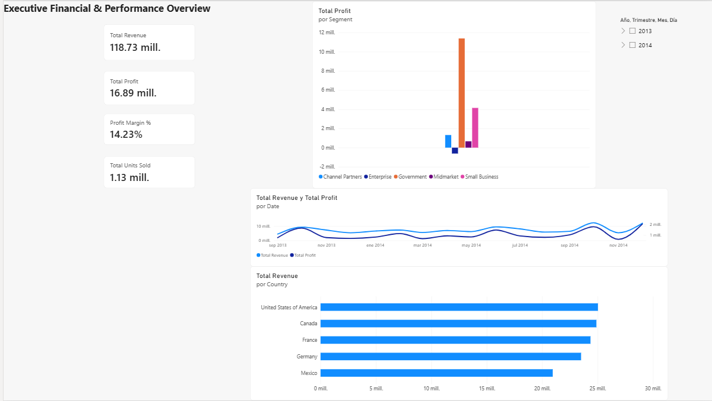

# Executive Financial Performance & Sales Dashboard (Power BI)

## Project Overview
This Business Intelligence project delivers an interactive executive dashboard designed to monitor and evaluate corporate financial performance, gross sales revenue, and operating profit margins across international regions and distinct customer segments.

## Dashboard Preview


---

## Technical Stack & Architecture
- **Business Intelligence Tool:** Microsoft Power BI Desktop
- **Data Transformation (ETL):** Power Query (schema validation, data cleansing, type casting)
- **Data Modeling & Analytics:** Custom DAX measures for dynamic margin calculation and temporal aggregations
- **Source Dataset:** Microsoft Financial Sample (700 global sales and accounting records)

---

## Key DAX Measures
The following custom DAX formulas were implemented to drive KPI metrics and multi-dimensional aggregations:

```dax
// Total Gross Revenue
Total Revenue = SUM(financials[Sales])

// Total Net Operating Profit
Total Profit = SUM(financials[Profit])

// Cumulative Volume Sold
Total Units Sold = SUM(financials[Units Sold])

// Profit Margin Percentage
Profit Margin % = DIVIDE([Total Profit], [Total Revenue], 0)
